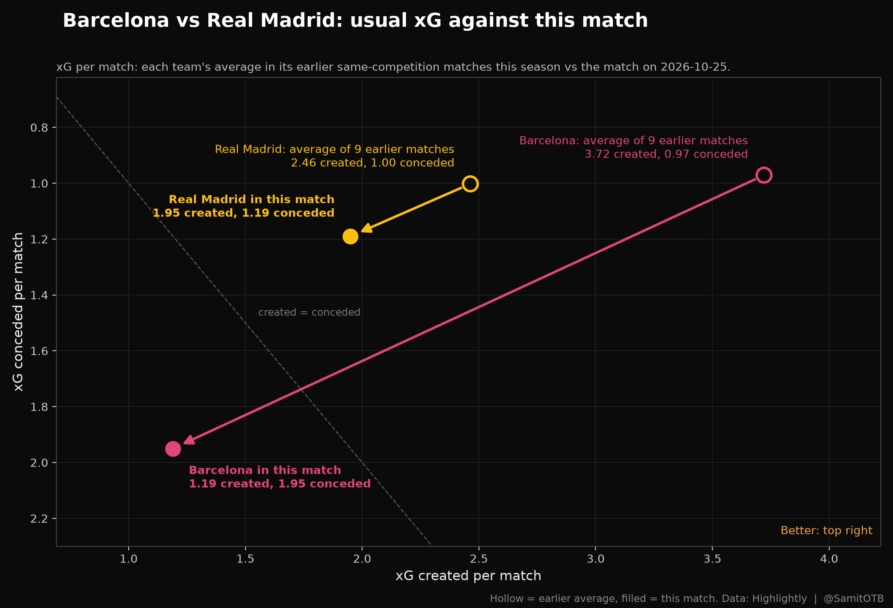

# Match Compare

Compare any football match with a team's other matches. See what changed at team and player level, with charts, rule-based findings, and an optional written summary whose every number is checked against the data.



*Example: Barcelona won all 9 of their earlier La Liga games, then created 68% less xG against Real Madrid. The full write-up is at [muhaiminsk.github.io/clasico-analysis](https://muhaiminsk.github.io/clasico-analysis/).*

## Try it
**Live app:** [samitontheball.streamlit.app](https://samitontheball.streamlit.app)

The first visit can take a minute: the free host puts idle apps to sleep. If you see a sleeping page, click "Yes, get this app back up!". You need a free Highlightly key (step 1 below) to load a team.

**Faster and more reliable: run it on your own computer** (about 5 minutes).

## Quick start
**1. Get a free data key.** Sign up at [highlightly.net](https://highlightly.net) and copy the API key from your dashboard. The free plan allows about 100 requests a day. Never paste your key into code or commit it.

**2. Install** (Python 3.11 or newer):
```bash
git clone https://github.com/muhaiminsk/match-compare.git
cd match-compare
python3 -m venv .venv
source .venv/bin/activate          # Windows: .venv\Scripts\activate
pip install -r requirements.txt
```

**3. Start the app:**
```bash
streamlit run app.py
```
Streamlit may ask for an email on the first run; press Enter to skip. A browser tab opens.

**4. Load a team.** In the sidebar choose **Highlightly**, paste your key, enter the team as Highlightly spells it (for example `Barcelona` or `Real Madrid`) and the season's start year (`2026` for 2026/27), then click **Fetch**. A match costs about 2 requests, so a team's season so far takes a minute or two. If the daily limit is reached, the fetch stops and keeps what it got; click Fetch again after midnight UTC to continue.

**5. Explore.** Pick a match and choose what to compare it with: the matches before it, all other matches, or the matches after it. You get the findings, charts, a starting-XI chart with a metric of your choice, and the biggest team and player changes.

**Optional: a written summary.** Create a file `.streamlit/secrets.toml` (one setting per line):
```
LLM_BACKEND = "openai"
OPENAI_API_KEY = "your_groq_key"
```
A free Groq key comes from [console.groq.com](https://console.groq.com). The summary appears at the top of the page, and every number in it is checked against the data. Without a model, the findings and charts still work. Providers retire models: if the summary shows a "404" error, set `OPENAI_MODEL` to a current model from the provider's list.

## What it does
- **Compares one match with a baseline you choose,** limited to the same competition and season.
- **Finds the biggest changes** at team level (xG, passes, tackles, duels, dribbles, offsides) and at player level (per 90 minutes: shots, key passes, passes, dribbles, duels, ratings, and more).
- **Judges players fairly.** Only statistics that matter for a player's position are considered (a forward is never judged on tackles), and a change must be big in absolute terms, not just in percent.
- **Writes findings with rules, not a model.** `matchreport/insights.py` holds the rules, so the same match always gives the same findings.
- **Checks the written summary.** A model only rewrites the findings as prose; a validator then confirms every number exists in the data and flags claims about positions the findings do not support.

## Command line
```bash
export HIGHLIGHTLY_KEY=your_key
python report.py fetch-hl --team Barcelona --season 2026
python report.py --team Barcelona --vs "Real Madrid" --source highlightly --no-llm
```
Each report is written to `reports/<team>_vs_<opponent>_<date>_<baseline>/`: `report.md`, CSV tables, charts, `findings.txt`, and (with a model) the exact prompt and `validation.json`. Add `--baseline all` or `--all-competitions` to change the comparison.

## Data sources
Every source is an adapter that writes the same three tables (`matchreport/schema.py`), so adding a source means writing one adapter.

| Source | Provides | Notes |
|---|---|---|
| **Highlightly** (`sources/highlightly.py`) | per-player passes, key passes, dribbles, duels, tackles, interceptions, offsides, match rating, xG and xA; team xG; lineups | Current season, every major competition. Free plan: about 100 requests a day. No shot locations |
| Understat (`sources/understat.py`) | match xG, every shot with location, player xG, xA, xGChain, xGBuildup | Scrapes a website on demand. Hidden in the live app; set `MR_ENABLE_UNDERSTAT=1` to show it locally |
| API-Football (`sources/apifootball.py`) | per-player passes, tackles, dribbles, duels, ratings | Free plan covers seasons 2022 to 2024 only. Fetch with `python report.py fetch-api ...` |
| Manual CSV (`sources/manual.py`) | team-level goals and xG entered by hand | Each row cites its source URL |

Highlightly's terms allow storing data and showing it in your own site and articles, and forbid passing it on as data (exports, feeds, datasets). Fetched files therefore stay out of this repository.

## Tests
```bash
python -m pytest -q
```
The tests run against fake servers that copy the providers' response formats, so they need no keys and no network.

## Limitations
- The baseline is a plain average of other matches; it does not adjust for opponent strength.
- One match is one match: the findings describe what changed, not why.
- xG depends on the provider's model; two providers can disagree on the same match.
- Players need 60+ minutes in the match and 90+ earlier minutes to get a usual value. Others still show this match's value.
- The validator checks numbers and position words, not every sentence.
- Players are matched within one source only; sources are not merged at player level.

## Deploy your own copy (free)
1. Fork or push this repo to GitHub (public).
2. At [share.streamlit.io](https://share.streamlit.io), create an app from it with `app.py` as the main file.
3. Optional: add the two summary settings above under the app's **Settings, then Secrets**. Do not add your data key: visitors paste their own.

## Data attribution
Highlightly (highlightly.net), Understat (understat.com), API-Football (api-football.com). Manual rows cite their source URL.
